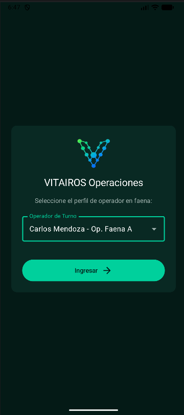
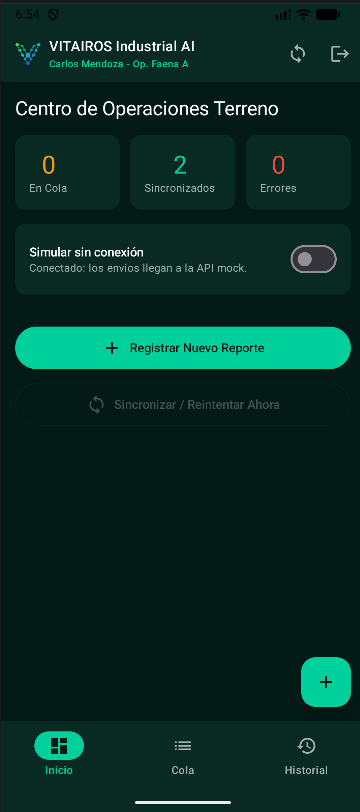
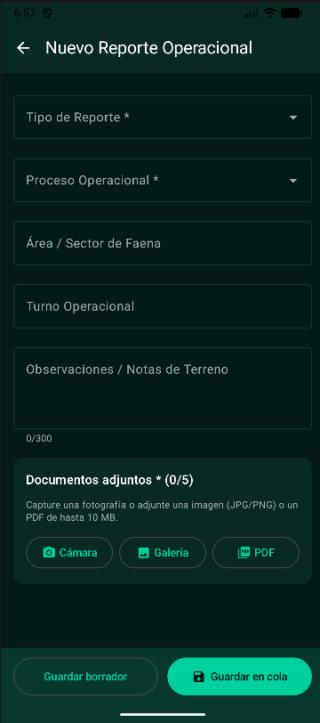
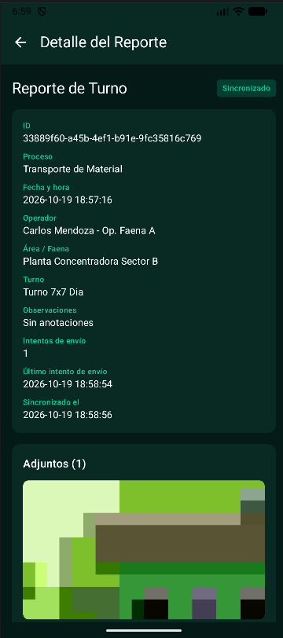

# VITAIROS App · Captura móvil de reportes operacionales

MVP académico para **VITAIROS Industrial AI**, desarrollado en la asignatura Desarrollo de Aplicaciones Móviles (Duoc UC).

La app permite a un operador de terreno capturar o seleccionar un reporte (foto o PDF), asociarle su contexto mínimo, guardarlo en el teléfono aunque no haya internet y sincronizarlo después con una API simulada, con visibilidad del estado de cada envío.

Todo el proyecto usa datos sintéticos. No contiene reportes productivos, datos personales reales, credenciales ni integraciones con sistemas de terceros.

---

## Funcionalidades

- Login simulado con perfiles de operador ficticios y cierre de sesión.
- Dashboard con contadores (en cola, sincronizados, errores) y pestañas "Inicio", "Cola" e "Historial".
- Formulario de reporte con tipo y proceso (listas cerradas), área, turno y observaciones.
- Validacion por campo en vivo y al guardar, con borde rojo, ícono y mensaje de error; reglas condicionales según el tipo de reporte.
- Adjuntos (1 a 5 por reporte) desde cámara, galería o PDF, con vista previa, ampliación y confirmación de legibilidad.
- Persistencia Online con Room (SQLite): los reportes sobreviven al cierre de la app.
- Estados de Reporte: Borrador, En cola, Enviando, Sincronizado y Error.
- Sincronización con API Mock: 1 envío + 3 reintentos automáticos (5, 15 y 30 s), reintento manual y sincronización automática al recuperar la conexión.
- Detalle de cada reporte con trazabilidad, edición mientras no esté sincronizado y eliminación con confirmación.
- Interruptor "Simular sin conexión" para demostrar el comportamiento offline.
- Recuperación tras cierre inesperado: los envíos interrumpidos vuelven a la cola.

## Capturas

| Login | Dashboard | Nuevo reporte | Detalle |
|---|---|---|---|
|  |  |  |  |

## Arquitectura

Patrón MVVM con flujo de datos en un solo sentido: la UI envía eventos al ViewModel, el ViewModel actualiza un StateFlow y la UI se redibuja con el estado nuevo.

Diagramas completos en `docs/`:

- `arquitectura_infografia.png`
- `arquitectura_tradicional.png`

### Estructura del proyecto

| Capa | Responsabilidad |
|---|---|
| **Model** | Forma de los datos: `ReporteEntity` (tabla) y `Estados` (constantes) |
| **Repository** | Puerta única de acceso a los datos; el ViewModel no conoce Room |
| **ViewModel** | Estado de pantalla, validación, guardado y sincronización; sobrevive a rotaciones |
| **Screens / Composables** | Dibujan el estado y reenvían eventos; sin lógica de negocio |

## Tecnologías

| Componente | Versión / detalle |
|---|---|
| Lenguaje | Kotlin 2.2.10 |
| UI | Jetpack Compose + Material Design 3 (BOM 2026.02.01) |
| Android Gradle Plugin | 9.4.1 (Kotlin integrado) |
| Persistencia | Room 2.7.2 + KSP 2.2.10-2.0.2 |
| Navegación | Navigation Compose 2.8.3 |
| Estado | ViewModel + StateFlow + Lifecycle 2.8.6 |
| Imágenes | Coil |
| SDK | minSdk 26 · targetSdk / compileSdk 37 |

## Estados del reporte

| Estado | Significado | Editable | Eliminable |
|---|---|---|---|
| Borrador | Guardado sin enviar a la cola | Sí | Sí |
| En cola | Esperando sincronización | Sí | Sí |
| Enviando | Envío en curso | No | No |
| Sincronizado | Recibido por la API mock | No | No |
| Error | Se agotaron los reintentos | Sí | Sí |

Un reporte sincronizado queda como registro de trazabilidad y no se edita ni se elimina.

## Reglas de negocio

- Obligatorias siempre: tipo, proceso y al menos un adjunto confirmado como legible.
- Condiciones por tipo:
  - Reporte de turno → turno obligatorio.
  - Inspección de seguridad → área obligatoria.
  - Falla operacional → observaciones de al menos 10 caracteres.
- Observaciones: máximo 300 caracteres.
- Adjuntos: JPG, PNG o PDF, máximo 10 MB, no vacíos, hasta 5 por reporte.
- Reintentos: 1 envío + 3 reintentos con espera de 5, 15 y 30 segundos; luego estado Error y reintento manual.

## Cómo ejecutar

Requisitos: Android Studio (versión reciente con soporte para AGP 9.x), JDK 11 o superior y un emulador con API 26 o superior.

1. Clonar el repositorio.
   ```bash
   git clone <https://github.com/quintopardo8/VitairosApp.git>
   ```
2. Abrir la carpeta en Android Studio y esperar el Gradle Sync.
3. Seleccionar el emulador y presionar Run.
4. Si cambió el esquema de la base entre versiones, desinstalar la app del emulador o usar Wipe Data.

## Guía de demostración

1. Reporte completo: Nuevo reporte → completar campos → adjuntar foto → confirmar legibilidad → "Guardar en cola".
2. Validación guardar con el formulario vacío; elegir "Reporte de turno" sin turno; elegir "Falla operacional" con una observación corta.
3. Permisos: tocar "Cámara" y negar el permiso (aparece el aviso con acceso a "Ajustes"); luego concederlo.
4. Sincronización: en el Dashboard, "Sincronizar" → ver Enviando → Sincronizado.
5. Offline: activar "Simular sin conexión", sincronizar y observar los reintentos hasta Error; desactivar el interruptor para ver la sincronización automática.
6. Persistencia: cerrar la app deslizándola y abrirla de nuevo; los reportes siguen ahí.
7. Edición y detalle: abrir un reporte desde la lista, editarlo mientras esté en cola, o reintentarlo si está en Error.

## Permisos y seguridad

| Permiso | Uso |
|---|---|
| `CAMERA` | Capturar evidencia fotográfica (se solicita en tiempo de ejecución) |
| `ACCESS_NETWORK_STATE` | Detectar si hay conexión para sincronizar automáticamente |

- Galería y PDF usan los selectores de sistema: la app no pide acceso amplio al almacenamiento.
- Los archivos se copian al almacenamiento privado de la app (`filesDir`).
- La cámara escribe mediante FileProvider no exportado, con permisos temporales.
- Se validan formato, tamaño y archivos vacíos; se eliminan los archivos huérfanos.

## Alcance y limitaciones

- Es un MVP: no corresponde al desarrollo definitivo ni a una publicación productiva.
- La API es simulada: responde correctamente solo si hay conexión.
- Fuera del alcance: procesamiento de IA y decisiones operacionales automáticas.
- Mejoras posibles: tabla propia de adjuntos, API REST real, perfil de supervisor y detección de duplicados.

## Equipo

Sebastián Pardo / Aarón Perez

Docente: Javier Sánchez 
---

Proyecto académico / Duoc UC / 2026
